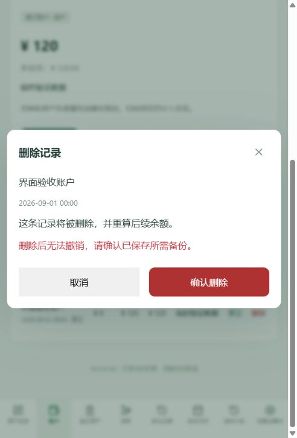

# 2026-10-03 账号、删除与备份更新

## 已完成

- 设置分类新增“账号与密码”。可单独修改账号、密码或同时修改，须验证当前密码；新密码须二次输入。服务端沿用账号格式、密码长度和认证限流，重复账号返回冲突；在事务中撤销全部旧会话并重新签发当前会话，财务数据和个人设置保留。
- 余额历史与资金往来使用统一删除弹窗，显示项目和时间、删除范围及不可撤销提示，默认聚焦取消。历史表中的配对记录支持直接修改完整资金往来，或一次删除双侧历史与资金往来；双方权限检查、删除和余额重算在同一事务内完成。
- 删除初始余额后，增量记录从零重算；删空历史的项目保留，余额为零，可以继续转账和执行计划支出。债务不能重算为负数，相关非法操作仍整体回滚；隐藏项目须先解锁，归档项目须先恢复。
- 修复 /auth/me 缺少隐藏授权和活动时间造成的重复刷新。修改后通过统一数据版本触发当前视图重新加载，刷新账户金额、历史和日历；避免创建项目切页时旧请求覆盖新页面，避免删除后顺带再次执行到期计划。范围切换仍只更新趋势。
- 备份支持零条历史的项目，以及以配对资金记录开头的历史。旧 JSON 上传兼容 UTF-8 BOM；导出事务上限调整为 5 分钟；备份内容摘要按计划 ID 排序，避免顺序造成假冲突。
- 备份下载先检查响应状态、ZIP 类型和非空内容，再发起保存；错误展示在页面中。清空流程仅在备份响应成功后进入保存确认步骤，仍须用户确认文件已保存。

## 验证

- 前后端 TypeScript 检查及生产构建通过；28 项单元测试和完整 11 项真实 MySQL 集成检查通过。
- 新增专项验证错误密码、重复账号、旧账号/旧密码失效、旧会话撤销、当前会话继续有效、隐藏授权状态、跨用户及隐藏配对删除拒绝、整笔删除、重复删除、零历史 ZIP 下载、上传预览、会话令牌隔离和追加恢复。
- 补充专项覆盖删空账户后执行支出计划、日历首条支出统计、继续转账和备份校验。
- 浏览器使用临时模拟账号验证账号设置表单、删除弹窗、余额更正后的详情和历史自动刷新，以及备份生成成功提示。浏览器自动化未能取得内置浏览器的下载文件事件，文件内容和上传/恢复使用真实 HTTP 集成测试验证；不能据页面提示证明用户已保存文件。
- 本轮临时账号和模拟财务数据已清理。删除最终提交及真实账号密码修改通过 API 临时账号测试；未操作实际用户的这些数据。

## 数据库与交付

复用现有 User、Session、Position、Revision、Transfer、Schedule 字段，无新增表或字段，无迁移；已有表与字段注释保持。未执行数据库 reset、db push 或实际用户数据清空。保留用户原有 vite.config.ts 修改，未纳入本轮功能提交。仅本地 Git 提交，不 push。

