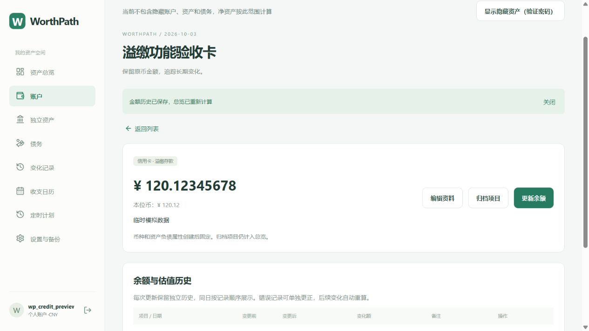

# 2026-10-03 负债账户溢缴存款

## 使用方式

信用卡和贷款等负债账户的余额输入、列表、详情及历史统一使用有符号余额：负数表示欠款，正数表示溢缴存款。例如欠款 100 填写 -100，溢缴存款 100 填写 100。零表示无欠款或存款。快速记账、余额更新、历史更正和新建账户使用相同规则，表单说明已同步更新。

溢缴账户标记为“溢缴存款”，正数不显示为负债红色；欠款和负向变化显示红色。溢缴款按原币和可用历史汇率计入总资产，欠款计入总负债，不用溢缴款抵消其他账户的负债。净资产始终按总资产减总负债计算，趋势和汇率归因也按同一逻辑重放。

收支日历沿用负债方向计算。例如从欠款 100 到溢缴存款 25，余额净增加 125；从溢缴存款 25 到欠款 10，余额净减少 35。初始余额、估值和配对资金操作仍按原规则排除。

## 数据与兼容性

数据库和现有 API 保留原来的负债本金符号：正数为欠款，负数为溢缴存款；网页输入和显示进行无损字符串符号转换。已有正数欠款数据仍表示同一欠款，原币金额没有批量改写。资产账户仍按原币余额存储和显示；独立资产及借入借出债务仍要求非负本金。

创建、更新、更正、删除后的历史重放和备份校验均允许负债账户的负余额。ZIP 恢复保存负债账户类型、原币和历史，不把项目永久改为资产类型；同一账户可以再次从溢缴转为欠款。此次未扩大账户转账或计划支持的账户范围。

复用现有字段，无数据库结构变更和新迁移。数据库已有表、字段注释保留；Prisma 的余额字段注释补充了负债符号含义，OpenAPI 补充了网页与 API 的符号约定。

## 验证

- 30 项单元测试、12 项真实 MySQL 集成检查通过；前后端类型检查和生产构建通过。
- 新增断言覆盖八位小数和大金额字符串无损转换、跨越零余额、溢缴款与其他债务分别汇总、历史趋势及 FX 归因、日历方向、更正和删除重算、跨用户和隐藏权限、ZIP 导出与恢复。
- 浏览器使用临时模拟账号，将欠款 -100 更新为溢缴存款 120.12345678，详情、历史和总览自动刷新；总资产 120.12、总负债 0.00、净资产 120.12。未操作实际用户账户或进行真实资金转移。
- 临时账号、模拟数据和预览配置在验收后清理。保留用户原有 Vite 配置修改，仅本地提交，不 push。

