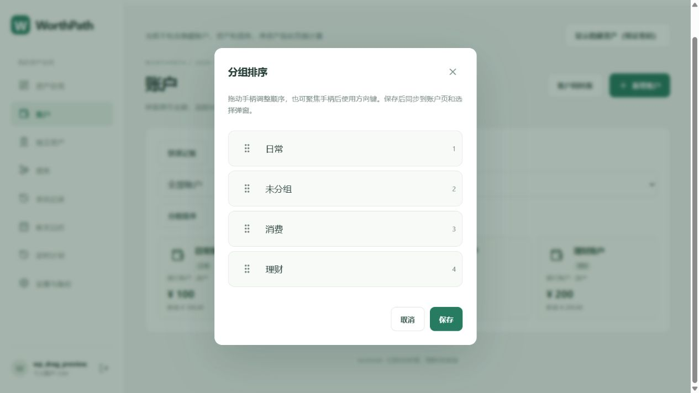
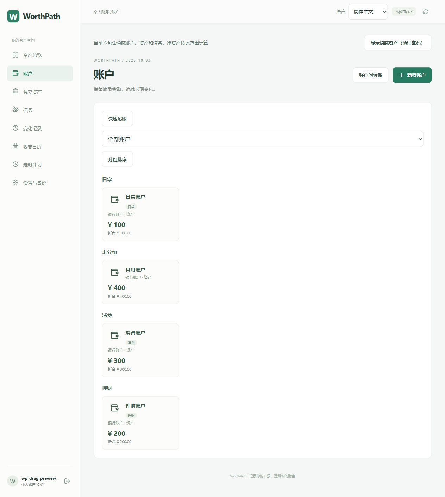

# 2026-10-03 分组拖拽与账户分行

## 使用方式

分组排序弹窗移除上下移动按钮，改为带拖拽手柄、分组名称和序号的列表。按住手柄拖到目标位置即可调整顺序，拖拽时高亮当前分组，靠近列表边缘自动滚动。点击保存后，账户页、分组筛选及账户选择弹窗同步使用新顺序；取消弹窗不会保存。

手柄支持鼠标、触屏和触控笔的 Pointer Events；44 像素操作区域与 touch-action 防止拖动手柄时页面误滚动。键盘可聚焦手柄后使用上下方向键调整、Home 置顶、End 置底；拖动过程中 Esc 或指针取消会恢复本次拖动前的顺序。辅助状态提示当前位置。

“全部账户”按保存顺序显示分组标题；标题横跨卡片网格，因此每个分组从新行开始。相同分组内仍使用响应式卡片排列；选择单一分组时只显示该组账户。未分组仍为独立分组。

复用现有 User.accountGroupOrder、settings 和备份协议，未增加数据库表或字段，不改变余额和财务记录，无需新增数据库迁移或依赖。

## 验证

- 前端类型检查和生产构建通过；33 项单元测试通过，新增重排测试覆盖跨多项插入、保持相邻顺序、不修改输入及边界处理。
- 真实 MySQL 分组排序专项检查通过：顺序持久化、用户隔离、非法输入拒绝、ZIP 恢复及旧备份兼容。此次未重复执行其他 12 项后端专项，上轮完整 13 项回归记录保留。
- 浏览器专用虚构账号：将“日常”从末尾实际拖到首位；取消后重新打开仍为原顺序；验证 Home、End 和方向键移动；再次拖拽并保存后刷新，账户页与选择弹窗保持“日常、未分组、消费、理财”顺序。
- 浏览器读取各分组标题和卡片的实际位置，确认不同组的卡片纵向分离，未共享同一行。
- 已检查桌面截图；触屏与触控笔使用统一事件实现，未在真实手机硬件上实测。
- 验收临时账号和脚本清理，保留用户原有 Vite 配置改动；仅本地 Git 提交，不 push。

完成时间：2026-10-03 17:04。

