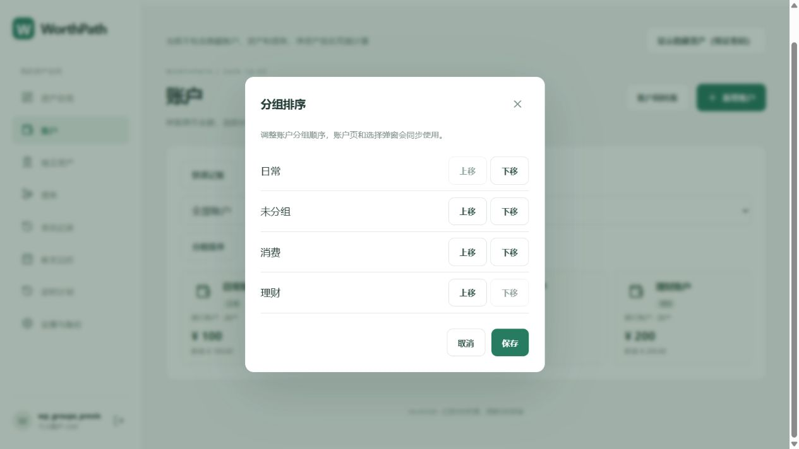

# 2026-10-03 账户分组排序

当前排序界面已改为拖拽；最新操作及全部账户分行行为见 [后续更新](update-group-drag-2026-10-03.md)。以下保留首轮验收记录。

## 使用方式

账户页点击“分组排序”，使用“上移／下移”调整分组后保存。顺序同步用于账户分组筛选、全部账户卡片、分组输入建议以及转账、借贷操作和定时计划中的账户选择弹窗。刷新网页或重新登录后仍保留；取消不会保存。只有一个分组时排序按钮禁用，首尾按钮防止越界。

未分组以空字符串单独保存，与自定义名称“未分组”区分。保存时保留当前视图之外已有分组的顺序设置，未解锁的隐藏分组不会出现在排序面板或选择弹窗；新分组追加显示。分组名称作为用户内容保留原文，不参与界面文字翻译。

## 数据与备份

新增 User.accountGroupOrder 可空 JSON 字段，迁移 20261003000100_account_group_order 只增加字段并附中文注释；没有重置数据库或改写财务余额。顺序通过已认证用户的 PATCH /api/settings 保存，auth/me 和 settings 返回当前用户设置。最多 1000 个分组，每个名称最多 60 字符；空字符串允许，重复名称（包括去除首尾空格后重复）和非法类型拒绝。

JSON 与 ZIP 的 preferences 增加可选 accountGroupOrder，ZIP 读取白名单同步接受。空资产空间恢复备份顺序；已有资产空间沿用当前设置，重复备份仍由原有保护返回 409。旧 ZIP 和旧 JSON 缺少排序字段时继续兼容。账户排序只影响展示，不改变金额、历史和财务统计。

## 验证

- 32 项单元测试和 13 项真实 MySQL 集成检查全部通过；前后端类型检查及生产构建通过。
- 新增测试覆盖顺序持久化、用户隔离、重复与非法输入拒绝、空分组与同名分组区分、搜索子集顺序、隐藏分组偏好保留、ZIP 排序恢复及旧备份兼容。
- 浏览器虚构数据验收：将“日常”从末尾移到首位，保存、刷新后卡片与筛选选项维持同一顺序，账户选择弹窗依次显示“日常、未分组、消费、理财”。
- 14 个迁移已应用；真实数据库 9 张表、89 个字段均有注释，完整快照见 database-comments.json。
- 前几轮回归分别发现 ZIP 设置白名单遗漏和重复导入断言不符，已修复并复验。连续多轮运行触发登录限流后，重启独立验收 API 完成整套 13 项通过；没有降低应用限流保护。
- 提交扫描此前将虚构测试金额的数字误匹配为本地凭据，且执行步骤未阻止随后提交。已更换数值示例，确认没有新增连接配置或真实凭据表达式；扫描改为检查新增行，避免删除内容和未改上下文阻挡修复。模拟新增凭据、删除凭据、未改上下文、私钥及安全内容的 5 项扫描回归通过；提交前重新执行扫描。

临时验收账号与预览配置清理，保留用户原有 Vite 配置修改。完成时间：2026-10-03 12:27。仅本地 Git 提交，不 push。

